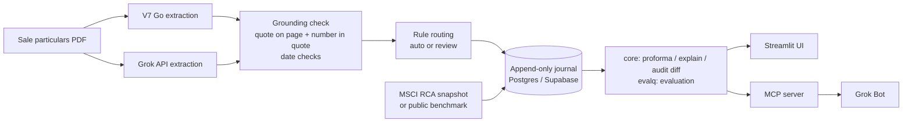

# TraceLease

TraceLease turns tenancy schedules into a proforma where every number traces back to a quote, a page, an author and an edit history — with an honest report of what the AI caught, missed, got wrong or invented.

## Problem and who it is for

An investment or underwriting analyst has to turn a data room of UK commercial sale particulars and leases into a rent roll, WAULT and value, then defend those numbers at investment committee. Key terms are scattered across long PDFs (tenant breaks often sit only in footnotes), it is unclear where an AI extractor was wrong or made something up, and numbers get copied between model, memo and email with no link back to the source or to who changed them and why.

## What it does (one point per screen)

1. **Documents & fields** — per-unit fields (tenant, CRN, area, passing rent, lease start/term/expiry, break, rent review), each with a verbatim quote and page, and the PDF page rendered with the quote highlighted.
2. **Evaluation** — V7 Go vs Grok against an automatically built reference: caught / missed / wrong / invented / ungrounded, per extractor and per field, with sample size, for one document or the whole corpus.
3. **Proforma & Explain** — rent roll, total rent, WAULT to expiry and to break, exit yield and simple gross value. Click any cell: formula, then input facts, then the highlighted PDF page or the market snapshot.
4. **Review queue** — fields that failed a rule (ungrounded, dates inconsistent, number not in quote, missing in one extractor, extractors disagree) wait for an analyst to confirm or correct, with a mandatory reason.
5. **Changes** — every proforma version with author, time and reason, and a cell-by-cell diff between versions.

### Hackathon tracks

| Track | What the brief asks | What TraceLease does |
| --- | --- | --- |
| 2 · Documents | Fields with quotes on the page; what was caught, missed, invented; more than parsing | Two extractors, grounding and date checks, rule routing, evaluation against an automatic reference, proforma |
| 3 · Provenance | Click a number, see its source, when it was added, how it changed; honest change record | Append-only journal, explain-a-figure graph, version diff, edits from UI or Grok Bot with author and reason |

## Architecture



The UI and the MCP server call the same `core` functions; neither has its own logic.

- `extract/` — `v7go.py` and `grok.py`; every response cached to `data/raw/<extractor>/<doc_id>.json`, reruns read the cache.
- `verify/` — `grounding.py` (quote must be found on the stated page, the number must appear in the quote), `dates.py` ("N years from" vs printed expiry, ±1 day), `routing.py`.
- `reference/` — deterministic Acuitus table parser and self-check that build the reference labels.
- `core/` — `proforma.py`, `explain.py`, `audit.py` (corrections, confirmations, diff), `store.py`, `pdf.py`.
- `evalq/` — scoring and `python -m evalq.export --md`.
- `market/` — exit yield from MSCI RCA, or a public benchmark if RCA is unavailable.
- `mcp_server/` — MCP server over Streamable HTTP for Grok Bot.
- `app/` — Streamlit UI.

## Data model

Eight tables in `db/schema.sql`. Rows are only ever inserted: database triggers reject `UPDATE` and `DELETE` on everything except `extraction_runs`. A correction is a new row with `supersedes_id`, and a check constraint rejects a superseding fact without a `reason`.

- `documents` — file name, sha256, page count, source.
- `extraction_runs` — one row per model run: extractor, model, prompt version, timings, tokens, cost.
- `facts` — one value per row with quote, page, bbox, grounding and date check results, review status, author, run, `supersedes_id`, `reason`; view `current_facts` gives the head of each chain.
- `snapshots` — external data (market yield) with query text, execution time, row count and result hash.
- `proforma_versions` — a full proforma snapshot with trigger fact, author and reason.
- `cells` — proforma cells with formula, input fact ids and input cell ids (the provenance graph).
- `labels` — reference labels with their source and self-check status.
- `eval_runs` — per-field evaluation rows: expected, got, verdict.

Authors: `model@version` (with `run_id`) for extraction, a person's name for manual edits, `grok-bot:<name>` for MCP edits, `rca@<snapshot_id>` for market data. A machine-extracted fact without a verbatim quote and a page never enters the proforma.

## Evaluation

**Reference labels are built automatically, not by hand.** No labelled set of UK tenancy schedules was available, so:

1. A deterministic parser (`reference/acuitus_parser.py`, PyMuPDF table extraction) reads the Acuitus "Tenancy & Accommodation" table and its footnotes.
2. A self-check (`reference/selfcheck.py`) compares the parsed unit rents and areas with the totals printed in the brochure and marks labels `agreed` or disputed.
3. A Grok arbiter for disputed labels was planned but is not built; disputed labels are kept out of the `agreed` scope instead of being resolved by a model.

Each extracted field is compared with its label:

| Verdict | Meaning |
| --- | --- |
| caught | value matches the label |
| missed | label exists, extractor returned nothing |
| wrong | extractor returned a different value |
| invented | extractor returned a value where the reference has none |
| ungrounded | the quote is not found on the stated page, so the value is blocked from the proforma |

**Routing.** A field goes into the proforma automatically only when every check passes for both extractors: quote grounded on the page, number present in the quote, dates consistent, both extractors returned it, and they agree. Otherwise it goes to the review queue with the first failing reason, in order: `ungrounded`, `date_inconsistent`, `number_not_in_quote`, `missing_in_one`, `extractors_disagree`. In the proforma a human fact beats an automatic V7 Go fact, which beats an automatic Grok fact; fields in review are skipped until confirmed.

### Results

Metrics are not reported for the corpus: this submission's database holds 3 brochures, and the demo document (The Hidings) uses seeded extraction errors to show how the checks react. Run `python -m scripts.run_pipeline --docs 15` and `python -m evalq.export --md` to produce corpus metrics with sample sizes.

### Caveats

- The reference is automatic (parser plus self-check), not a human-labelled gold set; parser errors on a document count against the extractors.
- One run per extractor; no repeat runs, so no variance estimate.
- Acuitus brochure template only. Other agents' layouts and full leases were not evaluated.
- Not tested: scanned PDFs, multi-property schedules, rent stepping beyond what Acuitus prints, prompt injection.
- Grounding stops invented values, not injected ones: text planted in a PDF is on the page and passes the check. TraceLease does not claim prompt-injection protection.

## Exit yield

`market.get_exit_yield` first tries MSCI RCA via Snowflake: a small sample of active UK transactions for the property's sector, the median yield, and a `snapshots` row with the query text, execution time, row count and result hash (author `rca@<snapshot_id>`). If RCA is unavailable it falls back to an analyst assumption quoted from a public benchmark (SEGRO H1 results, equivalent yield, page and quote stored), author `analyst-assumption`. The UI shows which source was used.

Value = total passing rent / exit yield. This is a simple gross value; purchaser's costs are not deducted, and the UI says so.

## Quick start

```bash
uv venv --python 3.13 .venv
uv pip install --python .venv/bin/python -r requirements.txt
cp .env.example .env            # fill in keys; never commit .env

# Postgres: Supabase (set DATABASE_URL) or local Docker
docker run -d --name tracelease-pg -p 5432:5432 \
  -e POSTGRES_USER=tracelease -e POSTGRES_PASSWORD=tracelease -e POSTGRES_DB=tracelease postgres:16

.venv/bin/python -m scripts.load_fixtures --reset          # applies db/schema.sql, loads the fixture document
.venv/bin/pytest -q

# Full pipeline (needs your own brochures in data/pdfs and data/corpus.txt)
.venv/bin/python -m reference.build_labels --all --store
.venv/bin/python -m extract.runner --docs data/corpus.txt --extractors v7go,grok
.venv/bin/python -m scripts.run_pipeline --docs data/corpus.txt
.venv/bin/python -m evalq.export --md

.venv/bin/streamlit run app/streamlit_app.py
.venv/bin/python -m mcp_server.server                      # http://localhost:8765/mcp, needs MCP_API_KEY
```

`scripts.run_pipeline` reads cached extractions only and makes no model calls. The MCP server requires `Authorization: Bearer $MCP_API_KEY` or `X-API-Key: $MCP_API_KEY` on every request and exposes `explain_figure`, `get_fact_history`, `eval_summary`, `review_queue`, `diff_versions` and `correct_fact` (edits are recorded with author `grok-bot:<name>` and a required reason).

## Data not in this repository

- **Brochure PDFs and rendered pages** — copyright of the selling agents. Documents are referenced by file name and sha256 only.
- **MSCI RCA rows** — licensed under a data use agreement. Code stores only the query text and a hash of the result.
- **Derived reference labels and extracted facts** (`data/`) — derived from the copyrighted brochures.

`fixtures/` holds a small excerpt for one document (page text, labels and two fact sets with planted errors) so tests run offline.

## Partner tools

| Tool | Role |
| --- | --- |
| V7 Go | Primary extractor: PDF to grounded tenancy-schedule fields with citations; its citations go through the same grounding check as Grok output |
| Grok API (xAI) | Second extractor with structured output; disagreement with V7 Go drives the review queue |
| Grok Bot + MCP | Ask questions and make reasoned corrections from chat through the TraceLease MCP server |
| Supabase | Postgres for the append-only journal |
| MSCI RCA | Market exit yield from a small sample of active transactions, stored as a reproducible snapshot |
| Cursor | Built with parallel Cursor agents, one per module, against frozen contracts |

## Limitations and next steps

- Acuitus template only; add parsers or a human-labelled set for other agents' layouts and full leases.
- Build the Grok arbiter for disputed reference labels and measure it against a small human-labelled sample.
- Repeat runs per extractor to report variance.
- Value is a simple gross figure; add purchaser's costs, rent reviews and void assumptions.
- Companies House checks on tenant CRNs are not wired in.
